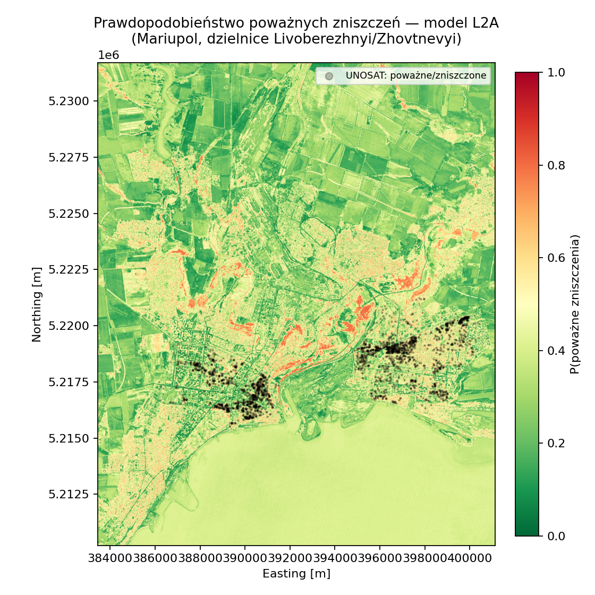

# War damage detection from free satellite data (Sentinel-2 + ML)

Analysis code from my master's thesis in Computer Science (KUL, Lublin), defended on
21 September 2026 (thesis grade 5.0): *"Automatic detection of urban destruction using
machine learning and satellite data"*.

**Question:** can free Sentinel-2 optical imagery (10 m) detect building damage reliably
enough to be useful, when checked against independent expert labels?

## What the code does

1. Samples pre-war (2020) and post-war (2025) Sentinel-2 spectral indices
   (NBU, NDBI, NDVI, NDMI, BU, rubble index; later NDRE, BSI, red-edge and SWIR2 bands)
   at every building assessed by **UNOSAT** (5,660 buildings, Mariupol, 12 May 2022).
2. Trains a **Random Forest** (400 trees, balanced classes, 70/30 stratified split + 5-fold CV)
   to separate severe/destroyed from possible/moderate damage, and a 4-class variant.
3. Compares it with a no-ML baseline (thresholding the rubble-index difference).
4. Repeats the experiment with better data (Sentinel-2 **L2A** from the public AWS STAC
   catalogue, cloud masking with SCL, full band set) and measures the gain.
5. Proof of concept on a second city (Kreminna) and a transfer test (Sumy).

| Script | Step |
|---|---|
| `01_build_dataset.py` | sample indices at UNOSAT points → `dataset_mariupol.csv` |
| `02_train_eval.py` | Random Forest, metrics, confusion matrices, feature importance |
| `03_improved_L2A.py` | L2A + full bands from STAC (30 features) |
| `04_figures_and_map.py` | figures and the damage-probability map |
| `08_poc_kreminna.py` | apply the model to Kreminna |
| `09_transfer_test.py`, `10_multicity.py` | does the pattern transfer to other cities? |

`DZIENNIK_ANALIZY.md` is the full analysis log (in Polish): data sources, decisions,
every experiment and its numbers.

## Results

| Model | F1 (severe) | ROC-AUC | Accuracy |
|---|---|---|---|
| Threshold baseline (no ML) | 0.543 | — | 0.482 |
| Random Forest, L1C, 18 features | 0.557 | 0.678 | — |
| **Random Forest, L2A + full bands, 30 features** | **0.589** | **0.705** | **0.650** |

**Conclusion:** the model works and is validated on independent ground truth, but free
10 m optical data gives only moderate accuracy: one pixel covers several buildings, and
optical bands carry little structural information. The bands missing from the basic
version (red-edge B6, SWIR2 B12) gave the largest gain. The next step would be Sentinel-1
SAR coherence, which the literature shows is the strongest signal for collapsed buildings.

## Running it

Python 3.11, `pip install -r requirements.txt`.
Input data is not included: put it under `data/` (or set `DATA_DIR`):

- `data/unosat/…`: UNOSAT damage assessments (free, from the Humanitarian Data Exchange,
  event CE20220223UKR);
- `data/rasters/…`: Sentinel-2 index rasters from a university GIS course (not redistributed).

Scripts 03, 04 and 08–10 download Sentinel-2 L2A scenes themselves from the public
Earth Search STAC API (no login). The trained model (100 MB) and large GeoTIFFs are
not in the repository; the figures and metrics in `wyniki/` are the thesis results.

## Data credits

Sentinel-2 imagery: Copernicus / ESA. Damage labels: UNOSAT / UNITAR.
